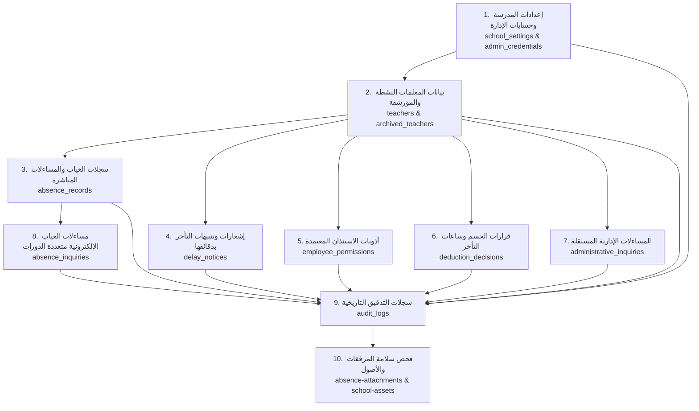

# دليل خطة التعافي من الكوارث واستعادة النظام (Disaster Recovery Runbook)
## منصة الغياب والمساءلات الإدارية المدرسية — الثانوية الخامسة مسارات

> **مستوى الوثيقة:** تشغيلي معتمد (P0 / P1 Operational Standard)  
> **تاريخ التحديث:** ربيع الآخر 1448هـ / أكتوبر 2026م  
> **البيئة المعتمدة:** الإنتاج والسحابي (Supabase PostgreSQL & Storage)

---

## 1. تصنيف مستويات الحوادث الطارئة (Incident Severity Classification)

| المستوى | طبيعة الكارثة | التأثير التشغيلي | الإجراء الفوري |
| :--- | :--- | :--- | :--- |
| **P0 - حرج** | انهيار كامل لقاعدة البيانات أو تلف السجلات أو حذف غير مقصود | توقف المنصة بالكامل وعدم إمكانية تسجيل الغياب أو الوصول للمساءلات | إيقاف الكتابة فوراً (Containment) وتفعيل خطة الاستعادة إلى بيئة معزولة |
| **P1 - مرتفع** | تلف أو فقدان حاوية تخزين المرفقات (`absence-attachments`) | تعذر فتح التقارير الطبية وإشعارات فارس | إعادة ربط الحاوية وتفعيل الروابط التخزينية البديلة (Data URLs / Backups) |
| **P2 - متوسط** | خلل في توكنات روابط المساءلات أو انقطاع خدمة الرسائل | تعذر إرسال الإفادة من قبل المعلمات | إعادة تجديد التوكنات الآمنة (Renewal) بمهلة 7 أيام جديدة (168 ساعة) |

---

## 2. إجراءات الاحتواء الفوري (Stop & Containment Procedure)

1. **تجميد العمليات التعديلية (Freeze Writes):**  
   في حال الاشتباه بوجود تلف أو اختراق، يتم تفعيل وضع القراءة فقط أو إيقاف الـ Vercel Deployment مؤقتاً لتجنب كتابة سجلات جديدة فوق الحالة المتضررة.
2. **سحب لقطة تشخيصية عاجلة (Diagnostic Snapshot):**  
   قبل إجراء أي استعادة، يتم أخذ لقطة فورية من حالة قاعدة البيانات والتخزين المحلي لحفظ الأدلة الجنائية وتحديد توقيت وقوع الخلل بدقة.
3. **حظر الاستعادة المباشرة على الإنتاج:**  
   **قاعدة صارمة:** يُحظر تماماً تنفيذ أوامر `DROP` أو `TRUNCATE` أو رفع ملف استعادة فوق قاعدة بيانات الإنتاج الحية مباشرة دون تجربة مسبقة في بيئة معزولة (Isolated Staging).

---

## 3. اختيار نقطة الاستعادة (Recovery Point Selection)

1. **النسخ الاحتياطية الموقعة رقمياً (Application Signed Snapshots):**  
   - الملفات الصادرة بصيغة JSON من داخل المنصة والموقعة بتوقيع `chk_...`.
   - يتم التحقق من سلامة التوقيع عبر دالة `validateBackupSnapshot()`.
2. **النسخ السحابية النقطية المدارة (Supabase PITR / Daily Dumps):**  
   - النسخ المأخوذة تلقائياً عبر منصة Supabase وتغطي آخر 7 إلى 30 يوماً.

---

## 4. خطوات الاستعادة المنهجية (Topological Restoration Sequence)

يجب الالتزام بالترتيب الهيكلي الدقيق لمنع كسر قيود المفاتيح الخارجية (`ON DELETE RESTRICT`):

---

## 5. استعادة حاويات التخزين السحابي (Storage Buckets Recovery)

1. **حاوية المرفقات (`absence-attachments`):**
   - **الخصوصية:** يجب أن تبقى خاصة بالكامل (`public = false`).
   - **السياسات (RLS):** 
     - القراءة محصورة فقط بحساب الوكيلة والإدارة المعتمد (`TO authenticated`).
     - الرفع مسموح للمعلمة عبر رابط المساءلة المعتمد (`TO anon, authenticated WITH CHECK bucket_id = 'absence-attachments'`).
2. **حاوية أصول المدرسة (`school-assets`):**
   - **الخصوصية:** عامة للقراءة (`public = true`) لعرض شعار المدرسة والختم والتوقيع على النماذج الرسمية وتصدير الـ PDF.
   - **السياسات:** التعديل والحذف محصور فقط بالإدارة المعتمدة.

---

## 6. قائمة التحقق الإلزامية بعد الاستعادة (Post-Restore Verification Checklist)

- [ ] **فحص الروابط الخارجية (Foreign Keys):** لا توجد أي سجلات غياب أو مساءلات تشير لمعلمات غير موجودات.
- [ ] **فحص دورات المساءلة (Multi-Cycle Inquiries):** المساءلة المرفوضة لسبب "مرفقات خاطئة" محفوظة مع إفادتها ومرفقاتها الأصلية، والمساءلة الجديدة المعاد إرسالها تعمل بتوكن مستقل.
- [ ] **فحص إحصائيات الغياب:** عدم تضاعف أيام الغياب في التقارير المدرسية للمعلمة التي مرت بعدة دورات مساءلة لنفس اليوم.
- [ ] **فحص دقائق التأخر وتصدير الـ PDF:** دقائق التأخر تظهر بدقة (مثال: 30 دقيقة / 6 دقائق) وسبب "أخرى" يظهر بنصه المخصص بخط Cairo والاتجاه RTL.
- [ ] **فحص صلاحية الروابط العامة:** الروابط الجديدة صالحة لمدة 7 أيام كاملة (168 ساعة) من تاريخ الإنشاء.
- [ ] **فحص أمان الحاويات:** حاوية `absence-attachments` مغلقة عن الوصول العام المباشر.
- [ ] **اختبار كتابة تحكمي (Write Test):** نجاح إضافة معلمة تجريبية وتسجيل غياب لها بدون أي تعارض في أرقام المعرفات (Sequences/IDs).

---

## 7. مؤشرات وقت ونقطة التعافي (RTO & RPO Metrics)

- **هدف وقت التعافي (RTO - Recovery Time Objective):**
  - استعادة اللقطة والتحقق من سلامة البيانات: **< 15 دقيقة**.
  - زمن معالجة وتدقيق مصفوفات البيانات برمجياً: **< 350 ميلي ثانية**.
- **هدف نقطة التعافي (RPO - Recovery Point Objective):**
  - مع تفعيل النسخ الاحتياطي التلقائي وسجل التدقيق: أقصى نافذة فقدان محتملة لا تتجاوز دورة العمل اليومية السابقة.
